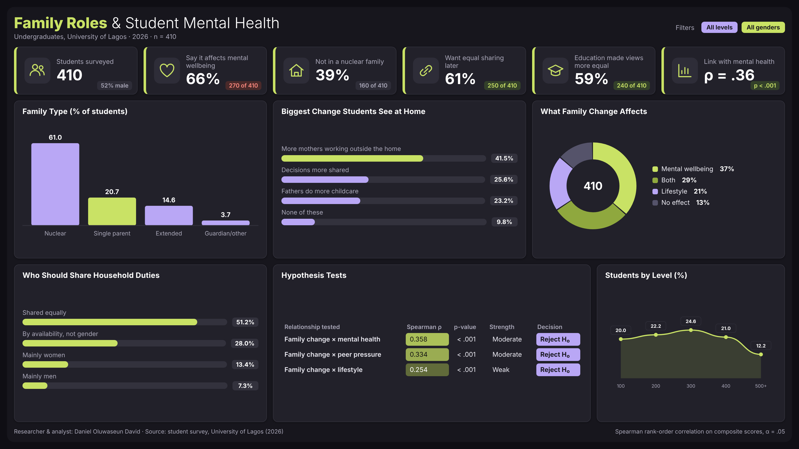

# Family Roles and Student Mental Health Analysis (University of Lagos)

Nigerian families are changing. More mothers now work outside the home, more students grow up with one parent, and roles at home are shared differently from before. This project looks at whether these changes are linked to undergraduates' mental health, the peer pressure they face and their lifestyle choices. The study surveyed 410 students at UNILAG and I did the analysis.

Key Points:
* Family structure is changing: a big share of students do not grow up in a nuclear family.
* Roles at home are shifting: mothers working, decisions being shared.
* Wellbeing: most students feel these changes affect them.

Tools I used: SPSS, SQL, Python (pandas), Excel, Power BI

Data: 410 undergraduates from 100 to 500 level, collected in 2026. The figures here come from the frequency tables in the final report.

## Objectives
1. Describe how family roles are changing
2. See how family functions have changed
3. Test whether these changes are linked to mental health, peer pressure and lifestyle

## Dashboard


## What I found
* 39% of the students do not come from a nuclear family, and 21% come from single-parent homes.
* The change students notice most is mothers working outside the home (42%).
* 66% said these changes affect their mental wellbeing.
* The Spearman correlations show family change is linked to mental health (ρ = .36), peer pressure (ρ = .33) and lifestyle (ρ = .25), all p < .001. The links are real but moderate to weak, so family change is one factor among many.
* 61% want to share responsibilities equally with a future partner, and 59% said education made their views more equal.

## Recommendations
* Counselling services that take students' family situations into account
* Peer support groups, since family change is linked to peer pressure
* Orientation sessions on handling independence and new responsibilities

## Repo structure
```
Data/
  frequency_tables.csv            every frequency table from the report
  frequency_tables_with_pct.csv   after percentages.py
Scripts/
  01_create_table.sql
  02_analysis_queries.sql
  percentages.py
Dashboard/
  dashboard.png / dashboard.html
  Excel workbook (dashboard, charts, data, tests)
```

## How to run it
1. Create the table with `Scripts/01_create_table.sql` and load `Data/frequency_tables.csv` into it.
2. Run `Scripts/02_analysis_queries.sql` for the percentages and the numbers on the KPI cards.
3. `python Scripts/percentages.py` does the same in Python and saves a table ready for Power BI.
4. Open the Excel workbook in the Dashboard folder, or load it into Power BI (Get data > Excel workbook).

Researcher and analyst: Daniel Oluwaseun David. No names or personal details are included.
